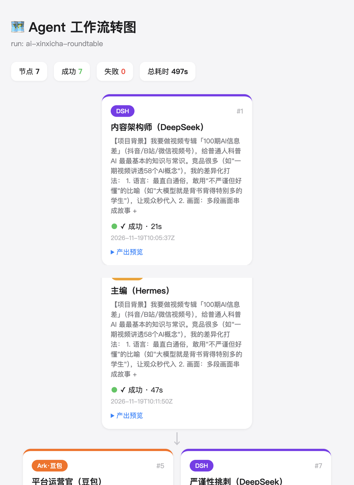
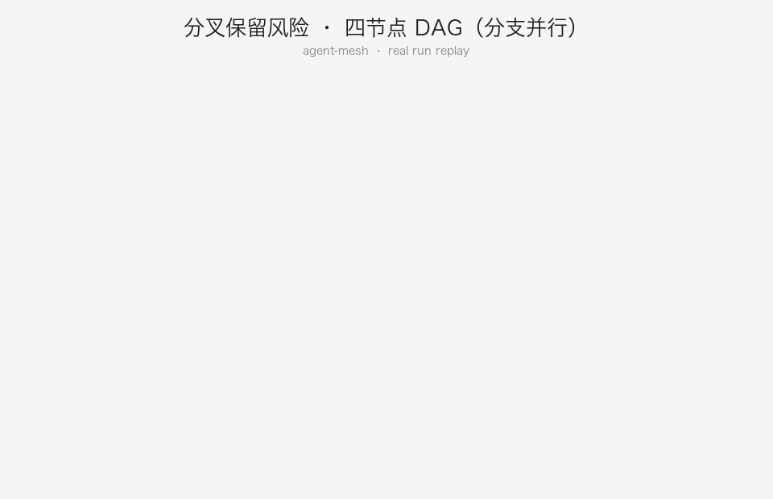
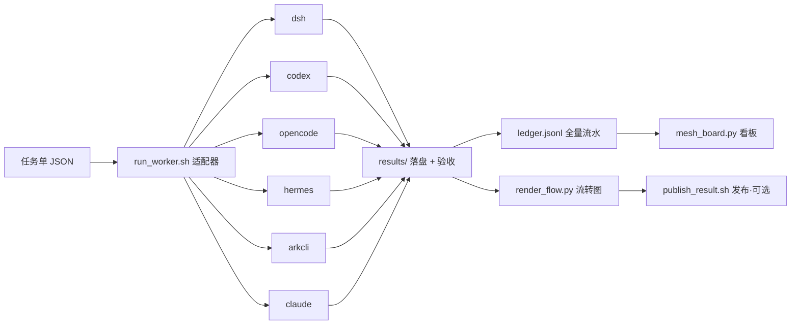

# agent-mesh

> 把多台 Agent CLI 编排成一个**可调度、可验收、可追溯**的多智能体协作网络。

**English** → [README_EN.md](README_EN.md)

[](LICENSE)


## 这是什么

<p align="center">
  
</p>
<p align="center">
  
</p>

你机器上装着好几个 AI 命令行工具（DeepSeek Harness、Codex、OpenCode、Hermes、ArkCLI、Claude Code……），每个都能非交互跑任务，但它们各自为政：没有统一调度、没有结果验收、没有运行记录。

agent-mesh 给它们套上一层**任务单驱动**的编排层：

```bash
./run_worker.sh task.json        # 派单给任一 worker，机器验收，结果落盘
./run_pipeline.sh pipeline.json  # 串行管线：A 起草 → B 复核（数据自动流转）
python3 run_dag.py dag.json      # DAG 并行：拓扑分层、层内并发、分支汇聚
python3 mesh_board.py            # 运行看板：历史/成功率/tokens 一页总览
```

一次跑通就是一张**流转图**：谁干了什么、耗时多少、成功失败、产出预览，全部留痕。

## 为什么是"多 Agent"而不是"一个大的"

每个 worker 都是一次 **fresh context** 调用——这是多 harness 编排的核心价值：根治长任务里的上下文腐烂（context rot）。再加一层**双引擎复核**（一个厂商的模型产出不信任，另一家独立复核），实测中复核抓出过截断假阳性、逻辑误判等真问题。

## 支持的 Worker

| Worker | 非交互入口 | 会话续接 | tokens 采集 | 备注 |
|---|---|---|---|---|
| DeepSeek Harness (`dsh`) | `dsh --profile headless` | `--session-id` | session 事件流（zstd） | 自带浏览器工具栈 |
| OpenAI Codex | `codex exec` | `exec resume` | stderr `tokens used` | 编码/review 强项 |
| OpenCode | `opencode run` | `-s <id>` | `export` JSON | 多 provider 模型 |
| Hermes | `hermes -z` | `--resume` | 会话库导出 | 轻量快速 |
| ArkCLI（火山方舟/豆包） | `arkcli +chat` | `--previous-response-id` | 响应信封 usage | json_schema 强结构化输出 |
| Claude Code | `claude -p` | `--resume` | 信封 usage + **cost_usd** | 凭据门控：配 `ANTHROPIC_API_KEY` 即激活 |

新 worker 接入只需在 `run_worker.sh` 加一个 case 分支，见 [docs/WORKERS.md](docs/WORKERS.md)。

## 快速开始

```bash
git clone <repo> && cd agent-mesh
./scripts/setup.sh          # 环境自检（依赖/CLI/可选能力）

# 1. 单任务派单（examples/tasks/ 有六家 ping 样例）
./run_worker.sh examples/tasks/002-ping-dsh.json

# 2. 串行管线（{{prev_output}} 把上游输出注入下游）
./run_pipeline.sh examples/tasks/pipeline-dual-review.example.json

# 3. DAG 并行（depends_on 声明依赖，{{nodes.N.output}} 任意引用）
python3 run_dag.py examples/tasks/dag-fanout.example.json
```

产物落在 `results/<task_id>/`：`stdout.txt` / `stderr.txt` / `answer.txt`（归一化正文）/ `result.json`（status、耗时、tokens、session_id、验收判定）。

## 任务单（Task Card）

```json
{
  "id": "my-task",
  "worker": "dsh",
  "brief": "任务描述，中文英文都行",
  "workspace": "/path/to/dir",
  "timeout_seconds": 300,
  "retry": {"max_attempts": 2, "backoff_s": 5},
  "session_id": "上一轮 result.json 里的 id，可续接",
  "done_criteria": {"stdout_regex": "验收正则"}
}
```

完整字段与 worker 专属参数见 `run_worker.sh` 头部注释（唯一事实源）。

## 架构



设计纪律：**规则路由优先**（按任务类型选 worker，别让 LLM 现场选）；**验收必须机器可判**（正则/schema，不要"看起来对"）；**节点间只传必要数据**（超长自动转文件引用）。

## 运维工具

```bash
./smoke.sh [--quick]   # 自检：语法+单元+六工人 ping+迷你管线（--quick 零成本）
./mem_test.sh          # 会话记忆验证：六 worker 两轮暗号复述
./prune.sh [--apply]   # 数据治理：30 天滚动清理（废纸篓可恢复）
```

## 应用示例

`examples/skills-governance/` 收录了一个真实应用：多 agent skills 目录的巡检、去重、中央库规范化（10 个 agent 目录、352 个 skill 的治理实战）。

## 许可证

**CC BY-NC-SA 4.0**（署名-非商业性使用-相同方式共享）——可自由使用、修改、分享，但**不得用于商业用途**，演绎作品须以相同条款发布并署名。商用授权请开 Issue 联系。

## 参与贡献

见 [CONTRIBUTING.md](CONTRIBUTING.md)；社区行为准则见 [CODE_OF_CONDUCT.md](CODE_OF_CONDUCT.md)；安全问题见 [SECURITY.md](SECURITY.md)。
