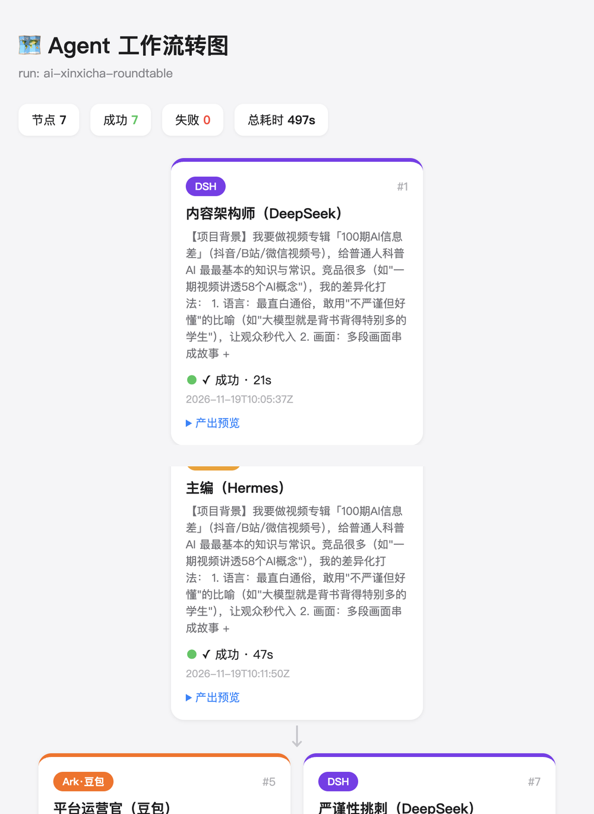
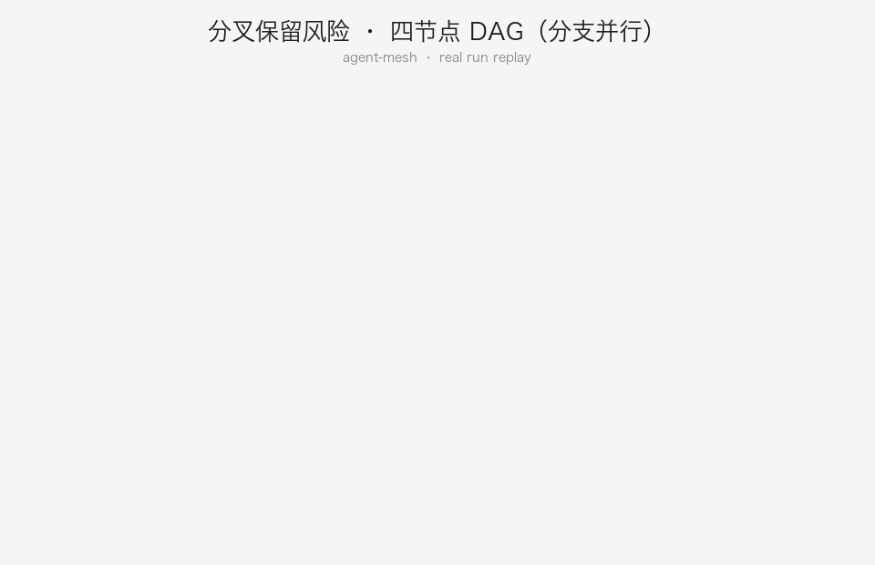
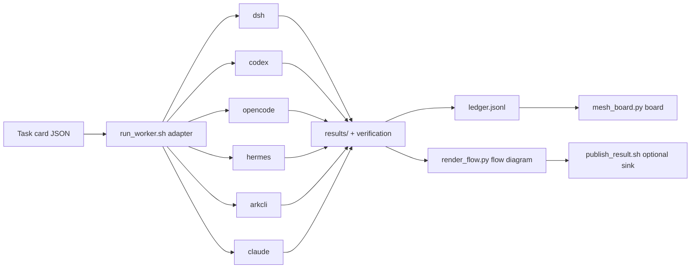

# agent-mesh

> Orchestrate multiple Agent CLIs into a **dispatchable, verifiable, traceable** multi-agent collaboration network.

**中文** → [README.md](README.md)

[](LICENSE)


## What is this

<p align="center">
  
</p>
<p align="center">
  
</p>

Your machine hosts several AI CLIs (DeepSeek Harness, Codex, OpenCode, Hermes, ArkCLI, Claude Code…). Each can run headless tasks, but they operate in silos: no unified dispatch, no result verification, no run history.

agent-mesh wraps them in a **task-card-driven** orchestration layer:

```bash
./run_worker.sh task.json        # Dispatch to any worker, machine-verify, persist results
./run_pipeline.sh pipeline.json  # Serial pipeline: A drafts → B reviews (data flows automatically)
python3 run_dag.py dag.json      # DAG parallelism: topological layers, in-layer concurrency
python3 mesh_board.py            # Ops board: history / success rate / tokens at a glance
```

Every run produces a **flow diagram**: who did what, how long, success/failure, output preview — all recorded.

## Why multi-agent instead of one big agent

Every worker call is a **fresh context** — the core value of multi-harness orchestration: it cures context rot in long tasks. Add **dual-engine review** (one vendor's output verified independently by another) — in production runs, reviewers have caught real issues like truncated-output false positives and logic misjudgments.

## Supported Workers

| Worker | Headless entry | Session resume | Token capture | Notes |
|---|---|---|---|---|
| DeepSeek Harness (`dsh`) | `dsh --profile headless` | `--session-id` | session event stream (zstd) | ships browser tooling |
| OpenAI Codex | `codex exec` | `exec resume` | stderr `tokens used` | coding/review |
| OpenCode | `opencode run` | `-s <id>` | `export` JSON | multi-provider |
| Hermes | `hermes -z` | `--resume` | session store export | lightweight |
| ArkCLI (Volcano Ark / Doubao) | `arkcli +chat` | `--previous-response-id` | envelope usage | json_schema structured output |
| Claude Code | `claude -p` | `--resume` | envelope usage + **cost_usd** | credential-gated: set `ANTHROPIC_API_KEY` to activate |
| Qwen Code | `qwen "prompt" --approval-mode yolo` | `--resume <id>` | `~/.qwen/usage_record.jsonl` | gemini fork, Alibaba Qwen |
| Pi (pi-mono) | `pi -p --mode json` | `--session <id>` | event-stream usage | richest event stream (thinking/tool calls), best sub-session experience |

Adding a worker is a single `case` branch in `run_worker.sh` — see [docs/WORKERS.md](docs/WORKERS.md).

## Sub-sessions: every run is clickable

Each dispatch renders `results/<id>/session.html`: worker badge, status/duration/tokens/cost cards, the brief, an **event-stream timeline** (thinking + tool calls for json-capable workers like pi), and a "continue in this context" card with a copyable `session_id` for the next task card.

**Environment isolation**: workers run under an env whitelist sandbox — host agent's approval/sandbox variables are stripped, so sub-tasks run entirely under **each worker's own auth and permission model**.

## Installation SOP: give your Agents agent-mesh

The caller of agent-mesh *is* an agent. Four steps and every agent on your machine can drive it:

**Step 0 · Install**

Option A · **npm (recommended)**:

```bash
npm i -g agent-mesh-tui     # one-line install; agent-mesh / mesh-tui commands ready
agent-mesh                  # launch TUI
npm i -g agent-mesh-tui@latest   # upgrade
```

Option B · git clone (developers):

```bash
git clone https://github.com/anthonyhann/agent-mesh.git && cd agent-mesh
./scripts/setup.sh    # checks python3/zstd/timeout/worker CLIs/optional capabilities
```

**Step 1 · Install the skill into all agents** (once, machine-wide)

```bash
./scripts/install-skill.sh --list   # preview target skill directories
./scripts/install-skill.sh          # symlink install (repo updates propagate everywhere)
```

**Step 2 · Restart your agent session and trigger in natural language**

Say to any agent (Claude Code / CatPaw / OpenCode / Cursor / Qwen…):

- "Dispatch task X to dsh"
- "Run a pipeline: A drafts, B reviews"
- "Analyze these three docs with a parallel DAG"
- "Show the ops board"

**Step 3 · Verify the chain**

```bash
./run_worker.sh examples/tasks/002-ping-dsh.json   # or just ask your agent: "run a ping via agent-mesh"
```

**Troubleshooting**: skill not discovered → restart the session; `ls -la ~/.claude/skills/agent-mesh` (or your agent's dir) should be a symlink into the repo. Agents working *inside* the repo need no install — `AGENTS.md` at root is auto-read (Codex/Claude Code/Cursor), and `llms.txt` provides an LLM digest.

## TUI: terminal UI (recommended entry)

```bash
agent-mesh    # after npm install
# or inside the repo: python3 mesh_tui.py
```

Zero dependencies (python3 stdlib curses). ↑↓ select · Enter confirm · q back/quit:

| Panel | Capability |
|---|---|
| Env check | python3/zstd/timeout + 8 worker CLIs + optional capabilities (workbuddy/claude key) |
| Install skill | preview and one-key symlink install into every detected agent skill directory |
| Quick dispatch | pick worker → type brief → run → status/duration/tokens/sub-session link on one screen |
| Run status | latest 12 runs, success rate, cumulative tokens |
| Examples | one-key pipeline / DAG sample runs |
| Ops | smoke self-check / prune cleanup |

## Quick start

```bash
git clone https://github.com/anthonyhann/agent-mesh.git && cd agent-mesh
./scripts/setup.sh          # environment check (deps / CLIs / optional capabilities)

./run_worker.sh examples/tasks/002-ping-dsh.json                 # single dispatch
./run_pipeline.sh examples/tasks/pipeline-dual-review.example.json  # serial pipeline
python3 run_dag.py examples/tasks/dag-fanout.example.json        # parallel DAG
```

Artifacts land in `results/<task_id>/`: `stdout.txt` / `stderr.txt` / `answer.txt` (normalized body) / `result.json` (status, duration, tokens, session_id, verification).

## Task card

```json
{
  "id": "my-task",
  "worker": "dsh",
  "brief": "Task description in any language",
  "workspace": "/path/to/dir",
  "timeout_seconds": 300,
  "retry": {"max_attempts": 2, "backoff_s": 5},
  "session_id": "id from a previous result.json, for continuity",
  "done_criteria": {"stdout_regex": "acceptance regex"}
}
```

Full field reference lives in the header comments of `run_worker.sh` (single source of truth).

## Architecture



Design rules: **rule-based routing first** (pick worker by task type, never let an LLM improvise the choice); **verification must be machine-checkable** (regex/schema, not "looks right"); **pass only what the next node needs** (oversized outputs auto-degrade to file references).

## Ops tooling

```bash
./smoke.sh [--quick]   # self-check: syntax + unit + six-worker ping + mini pipeline
./mem_test.sh          # session memory test: two-round passphrase recall per worker
./prune.sh [--apply]   # data hygiene: rolling 30-day cleanup (Trash-recoverable)
```

## Real-world example

`examples/skills-governance/` — a production case: auditing, deduplicating and consolidating skills across 10 agent directories (352 skills) into a central library.

## License

**CC BY-NC-SA 4.0** (Attribution-NonCommercial-ShareAlike) — free to use, modify and share, **no commercial use**; derivatives under the same terms with attribution. For commercial licensing, open an Issue.

## Contributing

See [CONTRIBUTING.md](CONTRIBUTING.md); community rules in [CODE_OF_CONDUCT.md](CODE_OF_CONDUCT.md); security in [SECURITY.md](SECURITY.md).
