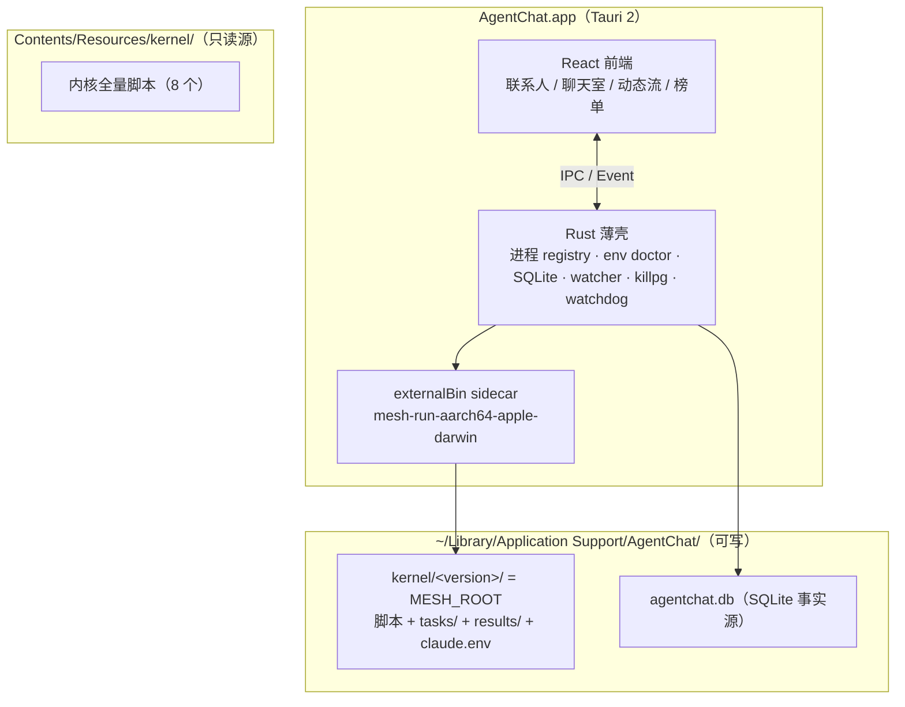

# AgentChat（圆桌派）设计方案

> v2.0 大版本提案 · v2.4（2026-11-26，codex 四轮技术评审 + dsh 产品评审全量吸收；详见 §0 修订记录）
> 定位：**中国版单人单机 ClawChat** —— 本地优先的 AI Agent Messenger。绑定本地 Agent CLI 为联系人，私聊续上下文，群聊人机混聊、Agent 主动接话，积分看贡献。

## 0. 评审修订记录

- **v1.0 → v1.1**：一轮 CHANGES-NEEDED（6 BLOCKER / 8 MAJOR / 5 MINOR）全部吸收：双根、SQLite 事实源、完成协议、并发矩阵、M0、安全章节。
- **v1.1 → v1.2**：二轮残留 4 项（B6/M8/R1/R2）→ 有界内核改动清单 K1-K4；§3 路径契约重写。
- **v1.2 → v1.3**：三轮残留 6 项，全部修正：超时唯一归属、env 精确白名单、sandbox 会话不可变、K4 reserved fields、原子写补入清单为 K0。
- **v1.4 → v2.0**：官方仓库源码级调研后纠偏 6 项（C1-C6，见 §0.2）。v1.4 的问题：只学了 ClawChat 的"形"（房间/权限档/接话），没学到"神"（回合制消息模型、turn 级权限快照、记忆三域、幂等台账）。
- **v2.0 → v2.1**：codex（4 BLOCKER/7 MAJOR）+ dsh（产品 CHANGES）双评审吸收：① C3 审批卡降级——CLI 工具在进程内部执行，无执行前拦截点，群回合 codex 强制 read-only、其他引擎 prompt 级约束+UI 警示，审批卡移 P2（待工具网关 spike）；② 轮数闸门合一（只留"自动轮数上限"）；③ A2A 默认定向派发（上次接话人/指定人），接话轮改房间级开关；④ M2 加即时打断（停止按钮+killpg）；⑤ 补 schema 迁移（§4.10）、`turns`/`room_members` 表、三类 ID 分离（§4.11）、摘要正文存储。官方调研依据固定 commit：hermes-agent@main / install-cli@871a619（2026-11-26，仓库 github.com/clawling/clawchat-plugin-hermes-agent、github.com/clawling/clawchat-plugin-install-cli）。
- **v2.2 → v2.3**：codex 三轮（2 BLOCKER/3 MAJOR/6 MINOR）吸收：① @ 只绕过 mention 闸门与合并窗口，**始终尊重 muted 与 auto_turn_limit**（§6.2）；② 重试契约：`runs` 唯一约束改 `(turn_id, persona_id, attempt)`，崩溃恢复把无结果 running 标 interrupted 后按 attempt+1 重跑（§4.3）；③ 迁移顺序定型：停写→时间戳备份（VACUUM INTO 事务外）→迁移事务→失败回滚保留备份；④ 新增 `room_persona_sessions` 表承接 K3 续聊校验；⑤ `room_history` 兼容查询 COALESCE(turn 关联, legacy_run_id)；⑥ 多 @ 每人独立 turn；⑦ 摘要游标绑定 `messages.id`（迁移重建保留原 id）。
- **v2.3 → v2.4**：codex 四轮（1 BLOCKER/2 MAJOR/6 MINOR）吸收：① **完成事务**定义（§4.3）：run 完成+回复气泡插入+turn persona 终态=单事务；恢复时发现 `runs.status=success` 但气泡缺失 → 按 `(turn_id, persona_id, attempt)` 幂等补写；② `room_history` join 规则定型（persona 消息按 turn_id+sender 取最新 attempt，user 消息不 join run）；③ 目标解析降级对每级生效（@ 无效→提示终止；default/last/owner 逐级跳过；全无效→系统提示不静默丢）；④ `room_persona_sessions` 换 session 时旧值入 `archived` JSON 列不静默替换；⑤ 迁移同步维护 `sqlite_sequence`、摘要游标与 messages 重建同事务、备份目录 0700+保留最近 5 份。

- **v2.4 → M2a-1 实施（2026-11-26）**：内核补一处会话契约修复——续聊任务结果 `session_id` 兜底为任务卡传入值（dsh 续接不改 session 目录 mtime，mtime 启发式在纯续接场景丢 id；结果 envelope §4.2 本就承诺 session_id）。
- **v2.4 → M2a-2 实施（2026-11-26）**：① lane 落地——`add_user_message_turn`（消息+turn 单事务，重复 client_msg_id 复用既有 turn 绝不双消费）、`complete_turn`（§4.3 完成事务：run 落库+气泡+turn 终态单 SQLite 事务；run 按 `(turn_id,persona_id,attempt)` ON CONFLICT DO NOTHING，气泡按 `(room_id,turn_id,sender)` 查重幂等）、`recover_scan`+`recover_pending_turns`（启动崩溃恢复：无结果 running→interrupted；run 成功缺气泡→幂等补写不重跑；run 缺失/failed→按 attempt+1 重跑，快照优先无快照按触发原文重建任务卡）；② send_message 全链路改走 lane，执行失败也落 failed 终态不悬挂 turn；③ UI 重做对齐 ClawChat——持久三栏暗色骨架（icon rail+会话列表+聊天区）、搜索框+「添加 Agent」卡、在线绿点+权限徽标、右侧用户蓝气泡+H 头像、时间分隔、三点 typing 动画、输入区工具条（⚡📎占位）+➤发送、前端自铸 clientMsgId 重试复用（§4.11 第一层幂等贯通到 UI）、窗口 1024×680(min 880×560)。验收：selftest_lane 四用例（重复提交单气泡 / 崩溃补写不重跑 / 崩溃重跑只补缺失 / failed→attempt+1）PASS；selftest_chat 真 dsh 两轮续聊回归 PASS；selftest_migrate 回归 PASS。
- **v2.4 → UI 打磨（2026-11-27）**：视觉语言两轮迭代定稿 Apple 体系（WhatsApp Dark × WeChat → Apple HIG）：① 图标全量 emoji→SF Symbols 风格内联 SVG（细描边 1.7、圆角、currentColor 单色）；② 配色 HIG 暗色——发出气泡 iMessage systemBlue #0A84FF、对方气泡 systemGray4 #3A3A3C、在线点 systemGreen #30D158、分隔线 0.5px 发丝线、文字 #F5F5F7/#98989F；③ 面板毛玻璃（backdrop-filter blur 28px saturate 1.6，rail/侧栏/头部/输入区）、头像圆形、气泡 18px 圆角 + iMessage 组尾切角、头像挂组尾、脚标悬停浮现、已读回执改 Messages 式「已读/已送达」挂最后一条我方消息、时间分隔居中小灰字、发送钮蓝色圆形 ↑。GUI 截图验收通过。
- **v2.4 → M2a-3 实施（2026-11-27）**：① send_message 异步化——command 入队即返回（add_user_message_turn 单事务后立即回执历史），lane_dispatcher 线程 300ms tick 经 recover_scan 消费非终态 turn，按房间 inflight/dispatched 守卫（同房间串行、跨房间并行），worker 经 mpsc 回报完成；AppState 改 Arc 共享；② typing 节奏（C6）——ac://typing start/beat/end 事件，watchdog 内 ≤1.5s/拍节流，前端 6s 无拍自动熄灭，complete_turn 落泡后推 ac://history 触发刷新；③ §6.8 即时打断——AppState 新增 active（run_id→{pgid,room_id}）/cancelled 注册表，stop_turn 命令按 room_id 置取消标志，watchdog 200ms 轮询命中即 killpg(SIGTERM)→≤5s 优雅期（100ms 轮询）→SIGKILL，与超时同路合成 cancelled 记录，complete_turn 落 turn=cancelled 终态 lane 继续；前端 composer 在飞期间显示红色圆形停止按钮。验收：selftest_lane 4/4、selftest_cancel（0s killpg 落 cancelled 泡「[cancelled] 已停止」）、selftest_migrate、selftest_chat 全 PASS；GUI 验证 typing 气泡+停止按钮+[cancelled] 已停止气泡（run cancelled/synthesized=1/1s）。

### 0.1 内核改动清单（有界，仅 K0-K4，全部向后兼容 + smoke 回归）

| # | 文件 | 改动 | 三轮评审处置 |
|---|---|---|---|
| **K0** | run_worker.sh | `result.json` 写临时文件 + rename 原子提交；spawn 时先写 `running` 标记文件，完成时删除 | v1.2 遗漏，补入清单 |
| **K1** | run_worker.sh | `timeout` 调用前 `command -v timeout` 探测，存在则用、`MESH_TIMEOUT_BIN` 可覆盖；**不存在则直接 exec** | ⚠️ 超时唯一归属见 §4.8：内核 timeout 仅作内层保险（`timeout_seconds`），Rust watchdog 外层兜底，不会双杀；watchdog killpg 后由 **app 侧合成 `status=timeout` 的 run 记录**（写 DB，不伪造 result.json），UI 按超时气泡渲染；**合成后 app 显式清理 `running` 标记（DB synthesized 状态优先于残留 marker）**；**watchdog budget 按 `attempts × (timeout_seconds + backoff_s) + 30s` 计算**（app 侧固定 `retry.max_attempts=1` 时即 `timeout_seconds + 30s`），防止未来开启内核重试时被外层误杀 |
| **K2** | run_worker.sh | ~~PREFIX 增补~~（废弃，会漏宿主 `CODEX_SESSION_ID` 等控制变量）→ **per-worker 精确变量名 allowlist**：`CODEX_API_KEY` `OPENCODE_API_KEY` `HERMES_API_KEY` 等按 worker 逐一显式列出；`MESH_ENV_EXTRA_VARS`（空格分隔**精确变量名**）替代 EXTRA_PREFIX，校验拒绝空串/通配符及 denylist（`AWS_*` `GITHUB_TOKEN` `DYLD_*` `CODEX_SESSION_ID` `CODEX_THREAD_ID` `CODEX_PERMISSION_PROFILE` `CODEX_SANDBOX` 等宿主控制/敏感变量） | 防宿主变量泄漏；回归测试断言 `CODEX_SESSION_ID`、`AWS_SECRET_ACCESS_KEY` 不出现在子进程 env；per-worker allowlist 实现前逐一核对真实凭证变量名 |
| **K3** | run_worker.sh | codex 新会话支持任务字段 `sandbox`（默认 `workspace-write`） | ⚠️ **sandbox 会话级不可变**：`codex exec resume` 不支持 `-s`，故 `sandbox` 仅在建会话时生效；任务卡同时带 `sandbox` 和 `session_id` 且不一致时 **app 侧直接拒绝**（提示"该会话创建时为 X，如需切换请开新会话"），绝不静默降级。会话的 sandbox 建会话时记入 DB，续聊 UI 常驻显示 |
| **K4** | run_pipeline.sh | 节点字段透传，**reserved fields 除外**：`id` `worker` `brief` `seq` `label` `depends_on` 由 pipeline 生成值最后写入，节点同名字段不覆盖；其余字段原样透传 | 防 `{{prev_output}}` 渲染结果被原始 brief 覆盖；回归用例必须含 `{{prev_output}}` 接力 + 节点自定义字段透传断言 |

豁免原则：除 K0-K4 外不动内核行为。

### 0.2 v2.0 纠偏清单（C1-C6，源自官方源码调研）

| # | 纠偏 | v1.4 的偏差 | v2.0 修正 | 官方依据 |
|---|---|---|---|---|
| **C1** | **回合制消息模型** | 消息≈一次性任务卡，缺"每句都是一回合"的语义 | 每条消息进入**房间 lane 串行队列** → 渲染成带来源标注的 transcript 作为一回合 prompt → agent 每回合判断回复或 [PASS]；DM 每句必触发一回合 | 官方：「宿主只负责回答一个 turn」；每 chat 一条 lane 串行处理帧 |
| **C2** | **群聊三闸门 + 合并窗口** | 只有 maxAutoTurns 一个旋钮 | 三闸门：**禁言**（即时，只阻后续派发不杀在途 run）、**活跃度** all/mention（mention 未 @ 不接话；all 档非 @ 消息**合并窗口** ~10s idle / max-wait 30s 攒批一次性回复）、**自动轮数上限**（默认 3，每个 persona 回复计 1，**人类发言清零后续轮**、不撤在途，超限终态） | group-settings: reply_mode/batch_delay_seconds/turn_limit；GroupMessageCoalescer |
| **C3** | **turn 级权限快照（降级版）** | 权限档是房间静态字段 | 每回合冻结 **Grants 快照**：owner DM=房间权限档原样；**群内回合 codex 强制 read-only（OS 级硬边界）**，其他引擎 prompt 级约束 + UI 常驻警示「近似」；**审批卡降级 P2**（执行前拦截需工具网关 spike 验证后再承诺） | tool_grants.py 交集模型；现实约束：CLI 工具进程内执行无法拦截 |
| **C4** | **记忆 = Markdown 三域文件** | 未设计 | `~/AgentChatProjects/memory/`：`owner.md`、`agents/<persona_id>.md`、`rooms/<room_id>.md`，尾部 `<!-- agentchat:metadata -->` 结构化块；**域限注入 + app 受控写入**（群回合 prompt 只注入 owner+本群+该 persona；写入唯一入口 MemoryService）；段落去重；与对话记录分离 | clawchat_memory.py 三域 + memory_scope（按单机现实降级为 prompt 级） |
| **C5** | **历史滚动摘要压缩** | 未设计（无限增长） | 超预算（DM 25k / 群 15k token，按字符系数估算）触发滚动摘要：保留最近 8 条原文 + 摘要正文存 `room_summaries` 表；摘要任务走独立队列不占轮数上限，失败保留旧摘要记 `summary_error` | history-budget.md + 摘要正文存储修正 |
| **C6** | **消息幂等 + typing 节奏** | 无客户端消息幂等 | 消息 id = `msg-<ulid>` 客户端自铸，`messages` 表 `UNIQUE(room_id, client_msg_id)` 判重即够（单机单进程，不做三态状态机）；撤回写 tombstone；typing：run 在途节流刷新（≤1.5s/次，需 send_message 改异步 command + event），前端 6s 无刷新自动熄灭 | `_claim_message_once`（简化采用）；typing 1.5s/6s |

## 1. 对标与取舍（v1.4 重写：对标 clawling ClawChat）

**澄清**：clawchats.app 是同名比特币社交 DApp（钱包身份/上链/EXP），**不是**对标对象。真正对标的是 **clawling.com 的 ClawChat** —— AI Agent Messenger，其核心产品实现（官网 + B站实测视频 + 开源变体 Lenka0605/ClawChat 源码调研）：

| ClawChat 产品机制 | 要点 | AgentChat 映射 |
|---|---|---|
| Agent=完整账号（伙伴非 Bot） | 主动发起消息、自主加群、**Agent 间直接对话**、真实工具权限 | §6.2 主动接话 A2A 协议（full-a2a，已拍板） |
| 一键接入本地 Agent | Claude Code/Codex/OpenClaw/Hermes；"能跑命令、有自己运行环境的都能接"；连接器开源 | M1 绑定向导：检测 8 CLI+auth→勾选绑定→名片 |
| 私聊 | 选 Agent 起对话框，单聊默认用对方名字 | 私聊=隐式房间，房间名=对方名，session 续接 |
| 群聊 | 勾成员建群；**每群绑定项目文件夹**（自动建 ~/ClawChatProjects/<群名>）；**权限档 project/full/readonly**；**默认接话人 all/sequential/last/指定**；maxAutoTurns | §6.1 全部照搬（项目文件夹=~/AgentChatProjects/） |
| 不用@也干活 | 群里抛需求，Agent 主动接话、互相补充、按工作区经验**抢活** | §6.2 A2A 轮询协议：transcript 上下文+接话判定+maxAutoTurns |
| 私聊覆盖设置 dmSettings | 私聊里单独改模型/强度，恢复则跟随群 | 映射 workspace/sandbox 可覆盖项（模型/强度各 CLI 无统一概念，v1 跳过） |
| 多开成员 | 同一引擎多实例（ChatGPT2），活在群里 | persona 多开（已拍板支持）：§4.5 per-persona 锁 + session 隔离约束 |
| Liveware 小工具 / 截图发起任务 | 一句话生成小程序；截图直发 Agent | P2+ 候选，不进本期范围 |
| E2EE / 多平台 / 联合群 | 加密、手机端、跨机互联 | **不做**（单人单机定位矛盾） |

**不做**：多用户、钱包/链、公开注册、E2EE、跨机联合群、Liveware。

## 2. 技术选型：Tauri 2（已拍板）

Tauri 2 + React + TypeScript。内核脚本以 sidecar 打包复用。

- Rust 壳不按行数硬约束（预计 1500-2500 行），以可维护为准。回退 Electron 有真实迁移成本。
- externalBin 要求 `name-$TARGET_TRIPLE` 可执行文件，launcher 方案见 §3.2。

## 3. 架构：双根 + 薄壳



### 3.1 路径契约

内核脚本自定位 `MESH_ROOT=$(dirname $0)`，**一切随脚本走**：

- **只读源**：`Contents/Resources/kernel/` 放全部 8 个内核脚本：`run_worker.sh` `run_pipeline.sh` `run_dag.py` `render_session.py` `render_flow.py` `mesh_board.py` `redact.py` `prune.sh`。
- **可写副本**：首启复制到 `~/Library/Application Support/AgentChat/kernel/<version>/` 并 `chmod +x`。该目录即 MESH_ROOT——`tasks/`、`results/`、`claude.env` 自然落在其内，无任何特殊分支。
- `agentchat.db` 在 MESH_DATA 顶层（app 私有，内核不感知）。
- 升级：复制新版本到 `kernel/<new-version>/`，`results/` 迁移（symlink 或脚本，M0 定实现），旧版本保留可回滚。

### 3.2 sidecar launcher

`mesh-run-aarch64-apple-darwin`（Rust shim，逐个 codesign）子命令分发：

```
mesh-run worker   <task.json>        → exec zsh <MESH_ROOT>/run_worker.sh
mesh-run pipeline <manifest.json>    → exec zsh <MESH_ROOT>/run_pipeline.sh
mesh-run dag      <manifest.json>    → exec python3 <MESH_ROOT>/run_dag.py
```

- launcher 解析 MESH_ROOT（env `AGENTCHAT_MESH_ROOT` 或默认 MESH_DATA/kernel/&lt;current&gt;/），注入 doctor 解析的 PATH 与 `MESH_ENV_EXTRA_VARS`。
- **M0/M1 验收必须用 `tauri build` 的 .app 从 Finder 启动**，不接受 `tauri dev`。

## 4. 数据契约

### 4.1 任务卡

唯一事实源 = `run_worker.sh` 实际解析字段（另建 `docs/TASK_SCHEMA.md`，`AGENTS.md` 指向它）：

```json
{
  "id": "run-<uuid8>",
  "worker": "dsh",
  "workspace": "/path",
  "timeout_seconds": 900,
  "retry": {"max_attempts": 1, "backoff_s": 60},
  "brief": "……",
  "done_criteria": {"stdout_regex": "…"},
  "session_id": "可选，续聊显式传入",
  "sandbox": "可选，codex 专用，仅建会话时生效：read-only / workspace-write（默认）"
}
```

- `id` 校验 `[A-Za-z0-9._-]+`，拒绝 `..`；每次发送/重试生成新 id。
- **`sandbox` 与 `session_id` 冲突校验**（K3）：续聊任务带的 sandbox 必须等于该会话创建时的 sandbox（DB 记录），不一致 app 侧拒绝派单并提示开新会话。

### 4.2 结果 envelope

`results/<id>/` 产出：`result.json`（status / answer_preview≤500 字 / session_id / tokens / duration_s / criteria / started_at / finished_at）、`answer.txt`（完整正文，后写）、`stdout.txt`/`stderr.txt`、`session.html`（最后）。

前端 DTO：`{status, answer_text, answer_preview, session_id, tokens, duration_s, criteria, started_at, finished_at, artifact_paths}`。`answer_text` 按路径**按需读取**。

### 4.3 会话事实源：app 自有 SQLite

`agentchat.db` 表：

- `personas`：**联系人=persona**（同一 CLI 可多开：persona=engine+实例名+头像+主题色+绑定状态+凭证状态+`behavior_md`；如「文案 dsh」「代码 dsh」两个 persona 共用 dsh engine）
- `rooms`：私聊=隐式房间（name=对方 persona 名）；群聊=显式房间，字段：`cwd`（项目文件夹）、`permission`（readonly/project/full，grants 基线）、`reply_mode`（all/mention，管"何时回"）、`default_target_persona_id`（管"谁回"，可空）、`owner_persona_id`（群主 persona，建群时定）、`batch_delay_s`（合并窗口，默认 10）、`auto_turn_limit`（自动轮数上限，默认 3，人类发言清零）、`group_prompt`（群级行为覆盖）、`chain_react`（接话轮开关，默认关，§6.3）
- `room_members`（room_id、persona_id、per-member `muted`/`reply_mode` 覆盖）——不再用 JSON 字符串，避免读改写竞态
- `messages`（原文、房间、sender(persona|user)、→ turn_id、reply_to、**`client_msg_id` = `msg-<ulid>` 客户端自铸 + `UNIQUE(room_id, client_msg_id)`**、recall tombstone 标记、`legacy_run_id`（迁移保留列））；撤回行为：已进入 lane 未执行的 turn 一并取消，已执行的不追回
- `turns`（**房间回合持久化**：turn_id、room_id、trigger_msg_ids JSON、target_personas JSON、status、lane_seq、claimed_at、lease_until、attempt、`parent_turn_id`（A2A 链）、created_at、completed_at、cancel_reason、last_error）——lane 队列可由 DB 重建；启动扫描过期 claim 恢复
- `runs`（任务卡 snapshot、**grants 快照**、→ turn_id、status、attempt、spawn/exit、**synthesized 标记**、**`UNIQUE(turn_id, persona_id, attempt)`**）；**重试=同 turn 新 attempt**（新 run_id），崩溃恢复先把无结果的 running run 标 `interrupted` 再按 attempt+1 重跑；一条消息可 fan-out 多个 run，`messages.run_id` 单值废弃
- **三层幂等职责**：消息=`client_msg_id`（防重复提交）；turn=`turn_id`（防 lane 重复消费）；run=`(turn_id, persona_id, attempt)`（防重复执行）
- `room_persona_sessions`（**`PRIMARY KEY(room_id, persona_id)`**：session_id、sandbox、created_at、status、`archived` JSON 列）——群 session 按 room 隔离的权威记录，K3 续聊校验只读本表，不依赖最近一次成功 run 的 task_json；**更换 session 时旧值写入 `archived`**（不静默替换，可审计）
- `room_summaries`（**`PRIMARY KEY(room_id)`** 每房间一行：`summary_text` 正文、**`summary_through_msg_id`（绑定 `messages.id` 稳定 rowid，迁移重建 messages 时必须保留原 id 值）**、summary_tokens、model、prompt_version、summary_error、version）
- `approvals`（**P2**，依赖工具网关 spike；字段预留：scope/tool_name/args_hash/grant_expires_at）
- `run_nodes` / `scores`（EXP 流水）

重启恢复、续聊、EXP、接话调度全部以 DB 为准；`results/` 仅为不可变 artifact 仓库。

**完成事务（codex BLOCKER 处置）**：run 完成 + 回复气泡插入 + turn 该 persona 终态 = **单个 SQLite 事务**，不可分割。崩溃恢复时若发现 `runs.status=success` 但对应气泡缺失 → 按 `(turn_id, persona_id, attempt)` 幂等补写气泡后再标 turn 完成，绝不出现「run 成功但用户永远看不到回复」。M2a-2 验收必须含此崩溃点。

**room_history join 规则**：persona 消息按 `(messages.turn_id, messages.sender)` join `runs` 取**最新 attempt**；`legacy_run_id` 仅在 `turn_id` 为空时使用；user 消息不 join run。回归测试覆盖「一个 turn 三 persona + 一次重试」。

### 4.10 Schema 迁移（M2a-1 前置，codex BLOCKER-3/4 处置）

- `PRAGMA user_version` 版本化：v0=M1 旧库 → v1=v2.4 schema；
- **迁移顺序定型**：停写 → 生成带时间戳的唯一备份文件名（预检不存在）→ **`VACUUM INTO` 在事务外**完成一致快照（WAL 安全）→ 再开迁移事务 → 失败回滚并保留备份；验收含「迁移中途失败→从备份恢复→重启再迁」路径 + WAL 库迁移测试；
- 新增列直接 `ALTER TABLE`；`messages` 加 `UNIQUE(room_id, client_msg_id)` 需**重建表**（`INSERT SELECT` **保留原 `id` 值**供摘要游标引用、**同步维护 `sqlite_sequence`** 防自增冲突；backfill `client_msg_id = 'msg-legacy-' || id`；**`room_summaries.summary_through_msg_id` 游标与 messages 重建在同一迁移事务**）；
- 备份目录权限 0700，**只保留最近 5 份**备份自动清理；
- 旧 `messages.run_id` 改名保留为 `legacy_run_id`；**`room_history` 兼容查询**：`COALESCE`（turn_id 关联 runs，落空则 legacy_run_id 关联 runs），旧气泡 status/tokens 不丢；
- `rooms.members` JSON 字符串迁移为 `room_members` 表行 + backfill `owner_persona_id`=首个成员；
- 验收：M1 旧 DB 升级后历史会话可打开、旧气泡 status/tokens 不丢、续聊 session_id 不丢。

### 4.11 三类 ID 分离（codex MAJOR-4 处置）

| ID | 作用域 | 生成方 | 唯一约束 |
|---|---|---|---|
| `client_msg_id`（`msg-<ulid>`） | 用户/系统消息幂等 | 前端/命令层 | `UNIQUE(room_id, client_msg_id)` |
| `turn_id`（`turn-<ulid>`） | 房间回合（可 fan-out 多 persona） | lane 消费时 | PK |
| `run_id`（`run-<uuid8>`） | 单 persona 单次执行 | 派单时 | PK；**任务卡 `id` 字段 = run_id** |

§4.1 任务卡示例中的 `msg-<uuid>` 废止，统一 `run-<uuid8>`。

### 4.4 完成协议

- **权威信号 = 子进程退出**。退出后读 `result.json`（可解析且 `finished_at >= spawn_time`）+ `answer.txt`（存在）。
- watcher 仅辅助：按 run 独立目录监听、debounce、解析失败重试。
- K0 原子写消除旧结果残留；`running` 标记存在即视为在途。
- 气泡排序按 app 侧完成序号（`finished_at` 秒级精度不可靠）。

### 4.5 并发模型：per-persona / per-engine 两级矩阵

| engine | session_id 来源 | 并发策略 |
|---|---|---|
| dsh / codex / opencode / hermes / qwen | 全局最新会话反推 | **per-engine 锁**：首轮建会话**同 engine 全 persona 串行**（全局反推无法区分实例）；续聊（显式 session_id）可并行 |
| arkcli / pi / claude | stdout envelope 自带 id | 可并行 |

- **persona 多开**（已拍板）：persona 级锁管 UI 会话，engine 级锁管 CLI session 创建。同 engine 多 persona 并发**建会话**串行执行；每个 persona 建会话后记录自己的 session_id，续聊走显式 id 互不干扰。
- 续聊校验返回 session_id 与传入一致。race 模式同一 persona 最多 1 实例。

### 4.6 状态流 ≠ token 流

只承诺状态流：queued → spawning → running → validating → completed/failed/timeout，由 Rust 进程生命周期驱动。可选 tail `stdout.txt` 预览。不承诺逐 token 流式。

### 4.7 时间线展开

app 侧 event normalizer：dsh 读 zstd session 事件、codex 读 rollout JSONL、pi 读 NDJSON → 统一 JSON timeline。`session.html` 仅作浏览器 fallback；内嵌用 asset protocol / `convertFileSrc`。

### 4.8 进程生命周期与超时归属（K1 处置）

- **超时唯一归属 = 内核 `timeout_seconds`**（有 `timeout` 命令时由内核执行；无则由 Rust watchdog 执行同一值）。**watchdog budget = `attempts × (timeout_seconds + backoff_s) + 30s`**（app 侧当前固定 `retry.max_attempts=1`，即 `timeout_seconds + 30s`），只在内核超时失效时触发，**不会双杀**。
- watchdog 触发 → `killpg`（先 SIGTERM，5s 后 SIGKILL）→ **app 合成 `status=timeout` 的 run 记录**（DB synthesized 行 + 可选写 `results/<id>/result.json` 占位，标记 synthesized）→ **显式删除 `running` 标记文件**；后续读取以 DB synthesized 状态为准，残留 marker 不再视为在途。
- spawn 独立 process group（`setsid`）；Rust 持有 child handles，`RunEvent::Exit` 回收防 zombie。
- `runs` 表持久化 running；重启扫描标记 `interrupted`。窗口关闭默认后台继续；退出 app 确认是否终止在途任务。

### 4.9 EXP：app 侧 ExpService

| 事件 | 分值 | 备注 |
|---|---|---|
| 验收通过 | +10 | status=success |
| 竞速胜出 | +5 | winner 标记 |
| tokens 效率 | +3 | 低于房间中位数；**tokens=null 不计** |
| 超时/验收失败 | -5 | 含 watchdog 合成的 timeout |
| 凭证缺失跳过 | 0 | **spawn 前 preflight 判定**记录 skipped |

"擅长领域"：消息/房间领域 tag 聚合，M4 简化为手动标签。

## 5. M0：环境基座

- [ ] `tauri build` .app + 假 worker（shell stub），**Finder 启动**验证：双根复制、PATH 注入、结果写入、退出清理、签名
- [ ] **首次启动 doctor**：
  - 登录 shell 解析 PATH（`zsh -lic 'echo $PATH'`）缓存进 DB，spawn 注入；或设置页显式配置 CLI 路径
  - 依赖检查：python3、zstd、8 个 CLI 的**真实 auth 检查**（非 `--version`：dsh 查 gateway key、codex 查 `~/.codex/auth.json` 等）
  - `claude.env` 从 MESH_ROOT 加载；`MESH_ENV_EXTRA_VARS` 注入通道（K2 校验）
- [ ] Rust watchdog（§4.8）+ 假 worker 超时用例：验证 killpg + 合成 timeout 记录

## 6. 群聊：回合制消息协议（v2.0 重写，对齐官方 lane/turn 模型）

### 6.0 回合模型（C1 核心）

**Channel/Host 职责切分**（官方架构的灵魂，我们天然吻合）：Tauri+内核 = channel adapter（收发、lane 排队、合并、分块、typing、历史压缩、权限快照）；CLI agent = host（只回答一个 turn）。换 agent 零协议改动。

1. 用户消息落库（幂等，C6）→ **同一事务内创建 turn** 进入**房间 lane**（每房间一条串行 turn 队列，`turns` 表持久化可重建；coalescer 定时器与 lane 同属一个异步 actor，禁止多线程直接改批）；**一个 turn 可 fan-out 为多个 persona 的并行 run**（lane 串行的粒度是 turn 不是 run）；**崩溃恢复**：lease 过期 turn 重新 claim 时先查已有 run（`UNIQUE(turn_id, persona_id, attempt)`），无结果的 running 标 `interrupted` 后按 attempt+1 重跑，只补未完成的 persona，不重跑已成功 run；
2. lane 消费时渲染**回合 prompt**：
   ```
   [系统] 你在会话「{room_name}」中。{persona behavior 摘要}
   [系统] 本回合权限：{grants 快照}；项目目录：{cwd}
   {滚动摘要（如有，读 room_summaries.summary_text）}
   {最近 8 条原文，逐条带来源标注：[msg#12] 我(user): ... / [msg#13] 小码(codex): ...}
   ```
3. agent 每回合判断：回复正文 或 `[PASS]`（DM 默认每句都应答，仍允许 PASS）；
4. 回复落库 → 触发接话轮（§6.3）；全程 typing 节奏按 C6。

### 6.1 房间模型

- **建群**：勾选 ≥1 个 persona；1 人即成私聊（房间名默认=对方名）；
- **项目文件夹**：每房间绑定 `cwd`，留空自动建 `~/AgentChatProjects/<群名>/`（非法字符转 `-`），作为房间内所有 persona 任务卡的 `workspace`；
- **权限档**：`readonly` / `project`（默认）/ `full`——**作为 grants 快照的基线**，每回合冻结进 prompt + 任务卡（见 §6.4）；
- `auto_turn_limit`（0-20 默认 3，-1 无限）：自动轮数上限（§6.2 唯一轮数闸门，v2.1 闸门合一后不再有独立接话轮上限）。

### 6.2 群聊三闸门（C2，即时生效的 UI 开关；v2.1 闸门合一，v2.2 目标语义统一）

**两个正交维度**：`reply_mode` 管"**何时回**"（闸门），目标解析管"**谁回**"（定向）。二者不交叉。

| 闸门 | 取值 | 语义 |
|---|---|---|
| 禁言 `muted` | bool | 即时生效：只阻后续派发，**在途 run 不杀**（要杀用 §6.8 停止按钮） |
| 活跃度 `reply_mode` | `all`（默认）/ `mention` | mention：未 @ 不产生回合；all：非 @ 消息进**合并窗口**（idle `batch_delay_s`=10s 或 max-wait 30s），窗口关闭时把攒下的消息合成**一个 turn** 派给解析出的目标 persona |
| 自动轮数 `auto_turn_limit` | 默认 3（0-20，-1 无限） | 自上次**人类发言**起，每个 persona 的每次回复（含 @必答）计 1；达上限该 persona 本轮及后续自动轮跳过（同 turn 其他 persona 的 run 继续）；人类发言**清零后续轮计数**，不撤在途 |

**目标解析优先级**（`谁回`）：`@指定人` > `default_target_persona_id`（房间设置）> 上次接话人 > `owner_persona_id`（群主 persona）。解析结果为**单人**；多人并行只由 `chain_react` 接话轮产生（§6.3）。

**@ 与闸门/批次的交互**：@ **只绕过 mention 闸门与合并窗口**，**始终尊重 `muted` 与 `auto_turn_limit`**——被 @ 的 persona 已禁言 → 落系统提示「对方已被禁言」不派发；@必答计入轮数，达上限 → 终态不派发。@ 消息到达 → 立即为被指名者建独立 turn（**多 @ 时每个被指名人各建一个独立 turn**，同 lane 依序派发）；已在合并窗口内的其他消息批次**不取消、计时不重置**，窗口关闭后照常派给解析目标（@ 消息本身不进批，避免重复回复）。

**目标解析降级**：对每一级生效——@ 是显式指定，目标无效/禁言 → 落系统提示并终止该 @ turn；`default_target_persona_id` / 上次接话人 / `owner_persona_id` 逐级跳过已移除/已禁言/非成员目标；**全部无效 → 落系统提示「无可用接话人」，不静默丢消息**。房间设置 UI 提示失效目标。多 @ 的各独立 turn 共享同一 `trigger_msg_ids`，每个被指名 persona 的必答各计 1 轮 `auto_turn_limit`。

刷屏治理顺序照官方：先用开关（即时）再改人设（下轮生效）。

### 6.3 主动接话 A2A（full-a2a；v2.1 默认定向，省 token）

- **默认派发策略**：目标解析优先级 `@指定人 > default_target_persona_id > 上次接话人 > owner_persona_id`，**单人**派发，不做全员广播（dsh 评审：全员接话轮烧钱）；
- **接话轮 = 房间级开关** `chain_react`（默认关）：开启后，目标回复落库进入接话轮（上限 `auto_turn_limit`）：每轮 transcript 分发给本轮尚未发言、未禁言成员，`[PASS]` 不展示、token 计入 scores；全员 PASS 或达上限即停；
- **@必答链**：发言中 `@{persona}` 触发被指名者下一轮**必答**（不走 PASS 判定），链深度计入 `auto_turn_limit` 防死循环；
- 接话轮任务卡 `timeout_seconds` 默认 120（判定应便宜，走各 CLI 最便宜档位）；全程受 §4.5 并发矩阵约束。

与官方差异声明：官方 agent 是常驻进程自主决策；我们是**每回合派任务卡的无状态调度**，「主动」由 lane+接话轮模拟。体验对齐，成本可控。

### 6.4 权限快照（v2.1 降级版，codex BLOCKER-1 处置）

**现实约束**：CLI 工具在 agent 进程内部执行（dsh `--approval-policy never` / claude `bypassPermissions` / qwen `yolo`），app 无法在工具调用前拦截。因此：

- **Grants 快照**：每回合按发起者冻结——owner DM=房间权限档原样；**群内回合 codex 强制 `sandbox: read-only`（OS 级硬边界，唯一真实强制），且从 M3a 群聊开放第一天起生效**（K3 会话不可变：群 session 按 room 隔离并记录 sandbox，绝不出现群会话从 workspace-write 升级的窗口；M3b 若发现历史遗留 workspace-write 群 session 直接拒绝并提示新开，不静默降级）；其他引擎 prompt 级约束（回合 prompt 注入「本回合只读，不要写文件/执行命令」）+ **UI 常驻「近似」警示徽章**，不谎称强制；
- **per-engine grants 能力矩阵**（M3b 补全）：codex=sandbox 硬强制；dsh/claude/qwen=prompt 级近似；arkcli/pi/hermes 逐一核对后填表；
- **DM sandbox 显式选择**：owner 开 codex DM 时显式选 read-only/workspace-write（K3 会话不可变），UI 说明「full grants 仍受 OS sandbox 限制」——不再同时承诺「默认安全」与「DM 全量」；
- **审批卡 → P2**：待工具网关 spike（MCP proxy / CLI hook / permission server 三选一验证）后再承诺；字段已在 `approvals` 表预留；审批交互预设走**系统通知+托盘**把人叫回来，不做房间内干等；
- **派单权 ≠ 授权权**原则保留：v1 阶段授权=房间权限档+DM sandbox 选择，全部 owner 显式操作。

### 6.5 Persona 行为文件（新增）

每 persona 一个 `behavior.md`（编辑入口在联系人名片）：身份/语言风格/擅长领域/**何时不发言**（官方经验：比何时发言更重要）/**回复篇幅约定**/**禁止输出内部推理**。群可在房间设置里追加 `group_prompt`（仅该群生效）。渲染回合 prompt 时注入（§6.0）。官方三原则照抄：先调何时不发言、约定篇幅、禁推理外露。

### 6.6 记忆与历史压缩（C4/C5）

- **记忆三域**（Markdown 文件，`~/AgentChatProjects/memory/`）：`owner.md`（用户偏好）、`agents/<persona_id>.md`（persona 自用）、`rooms/<room_id>.md`（本群约定）；尾部 `<!-- agentchat:metadata -->` 结构化块；**域限是 prompt 级隔离**（群回合 prompt 只注入 owner+本群+该 persona 三份），UI 明确标注「prompt 级隔离」，不宣称 OS 级边界（full/bypass 模式下 agent 物理上可读 HOME）；
- **写入唯一入口 = app MemoryService**，补丁协议定型：agent 回复中可带
  ````
  <!-- agentchat:memory-patch -->
  ```json
  {"scope": "room|self|owner", "op": "append", "text": "……"}
  ```
  ````
  app 解析后校验（**域白名单**：群回合只允许 `room`/`self`，DM 回合可加 `owner`；**限额**：单 patch ≤2000 字符、单回复 ≤5 个 patch）→ 段落去重 → tmp+rename 原子写；**多 patch 按出现顺序逐条生效**，单条失败不影响已成功条目（幂等去重保证重试安全），失败记入 run 的 `last_error`；补丁块从用户可见气泡中剥离；解析/校验失败**不阻塞回复**，回执记入 run 的 `last_error`；agent 不直接写文件，杜绝并发截断；
- **与对话记录分离**：记忆只存提炼内容，查逐句对话用消息表，不回记忆文件找；
- **历史滚动摘要**：DM 超 25k / 群超 15k token（**按字符系数估算**，无 tokenizer 依赖）触发压缩，保留最近 8 条原文；摘要正文存 `room_summaries`（PK=room_id，每房间一行）；**执行者选择**：优先 dsh（最便宜档），未绑定则取第一个已认证 engine；摘要任务走独立队列、**不占 `auto_turn_limit`、不产生可见 typing、不计 EXP**；输出为 `[PASS]`/空正文/执行失败 → 保留旧摘要记 `summary_error`；输出带 `prompt_version` 供升级重算；M2a 只建表，摘要逻辑 M4b 才启用（空表时 prompt 不读摘要段）。

### 6.8 即时打断（v2.1 新增，dsh 评审，M2 交付）

- 在途 run 的气泡/输入区旁常驻**停止按钮** → `killpg`（SIGTERM→5s→SIGKILL，watchdog 已有机制复用）→ run 落库 `status=cancelled`（合成记录，同 timeout 合成路径）→ typing 立即熄灭；
- 被 cancel 的 turn 标记终态，lane 继续消费下一 turn；DM 场景停止后 session_id 保留可续聊；
- 「插话」= 停止当前回合 + 新消息立即入 lane 队首。

### 6.7 race（保留，M5）

broadcast + winner 标记；v1 不取消输家；killpg 取消机制随 M5 落地。DAG 与 pipeline manifest parser 分开实现。

## 7. 签名与分发

- **Developer ID Application + notarize + staple**；"右键打开"不作方案。
- sidecar（target-triple 命名、执行位）逐个 codesign；CI 干净 Mac 验证 `spctl --assess` / `codesign --verify --deep --strict`。
- 证书流程 **M1 启动**；阻塞则只发源码 + Homebrew。
- 许可：CC-BY-NC-SA 4.0，分发附署名/非商业/相同方式共享说明。

## 8. 安全边界

worker 均为高权限模式（dsh `--approval-policy never`、claude `bypassPermissions`、qwen `yolo`、codex 默认 `workspace-write`）：

- 联系人级 **workspace allowlist**：默认仅授权目录
- 默认**安全模式**：codex 新会话默认 `sandbox: "read-only"`（K3），危险模式每次派单确认；**sandbox 会话级不可变**，切换须开新会话；**UI 常驻显示各 worker 权限模式标识**（dsh never / claude bypass / qwen yolo / codex sandbox 值），不可忽略
- 任务 `id` 校验 `[A-Za-z0-9._-]+`，禁止 `..`
- Tauri 最小 capabilities + CSP + isolation；LLM 输出默认转义，禁裸 `dangerouslySetInnerHTML`
- env 注入最小化：K2 精确 allowlist + denylist + 回归测试（防 `CODEX_SESSION_ID`/`AWS_*` 泄漏）
- `criteria_failed` 不无脑重试：引导改 brief 或转派；仅 timeout/failed 可一键重试

## 9. 里程碑

| 里程碑 | 内容 | 验收 |
|---|---|---|
| **M0 环境基座** ✅(2026-11-26) | 双根 + launcher + doctor + 假 worker + K0/K1/K2 内核改动及回归 | `tauri build` .app Finder 启动全链路绿；watchdog 合成 timeout 用例通过（38s=3+30+5 验证预算公式）；内核 timeout 路径 exit 124 验证；证书申请启动（待办） |
| **M1 绑定+私聊闭环** ✅(2026-11-26) | 绑定向导 + 会话列表 + 私聊对话框（真 dsh）+ SQLite 全表 + 完成协议 | 两轮真对话 session 续接验证通过；重启恢复；history 4 条 |
| **M2a-1 迁移+ID** ✅(2026-11-26) | §4.10 schema 迁移（user_version+`VACUUM INTO` 备份+messages 重建 backfill+legacy_run_id 保留）+ `turns`/`room_members`/`room_summaries` 建表 + 三类 ID 分离 | M1 旧 DB 升级后历史可打开、旧气泡 status/tokens 不丢、session 不丢 |
| **M2a-2 lane+幂等** ✅(2026-11-26) | lane 串行（turns 表持久化+lease+崩溃恢复：只补未完成 persona）+ 消息+turn 同事务 + 三层幂等（client_msg_id/turn_id/turn_id+persona_id） | 重复提交不产生重复气泡；崩溃后 lane 从 DB 恢复且不重跑已完成 run |
| **M2a-3 异步+打断** ✅(2026-11-27) | send_message 改异步 command+event（typing 节奏 1.5s/6s）+ **§6.8 即时打断**（停止按钮+killpg+cancelled 合成记录） | typing 6s 熄灭；停止按钮杀 run 落 cancelled，lane 继续 |
| **M2b 私聊全量** | 8 engine 全接入（§4.5 并发矩阵+K3）+ persona 多开 + behavior.md 编辑 + IM 质感（名片/在线状态/最近发言）+ 失败引导 | 每 engine 一轮私聊从打包 app 通过；同 engine 双 persona 各自续聊不串台；smoke 修 qwen/pi |
| **M3a 群聊房间** | 建群 + 房间项目文件夹 + 三闸门（禁言/活跃度+合并窗口/自动轮数）+ 目标解析链 + coalescer 与 lane 同 actor + **codex 群会话第一天起强制 read-only**（不留权限窗口） | 3 persona 群：mention 未 @ 静默；all 合并窗口攒批单人回复；@ 立即派发且批次不重复；codex 群会话 read-only 生效 |
| **M3b 权限快照** | grants 快照冻结进 turn/runs + 其他引擎 prompt 级约束+UI 警示 + per-engine 能力矩阵 + DM sandbox 显式选择 + 工具网关 spike（验证不过则审批卡正式归档 P2） | grants 快照落库可查；DM sandbox 显式选择路径通；能力矩阵文档化 |
| **M4a 主动接话** | §6.3 定向派发默认 + `chain_react` 接话轮开关 + @必答链 | 「@一人答→开 chain_react 后多 persona 补充」全链路；token 成本可控（默认定向） |
| **M4b 记忆+压缩** | C4 记忆三域（MemoryService 唯一写入+补丁协议+去重）+ C5 滚动摘要（room_summaries+独立队列+失败回退） | 记忆补丁写入去重生效；超预算房间触发摘要且最近 8 条原文保留；摘要失败旧摘要保留 |
| **M4c EXP+动态** | ExpService + 榜单 + 动态流 | 榜单与 DB 一致 |
| M5 race+发布 | race（含 killpg 取消）+ dmg 公证 + 双语 README + demo GIF | v2.0.0 tag；干净 Mac 双击可用 |

远期：worker 插件协议公开，第三方注册新 CLI 联系人（对齐 ClawChat 2027 Ecosystem）。

## 10. 遗留 MINOR（随里程碑处理）

- `run_worker.sh` 头部 worker 列表注释 5→8；新建 `docs/TASK_SCHEMA.md`（M1）
- `smoke.sh` ping 路径修正 + `setup.sh` 补 qwen/pi（M2）
- Rust 行数不设硬指标（全程）
